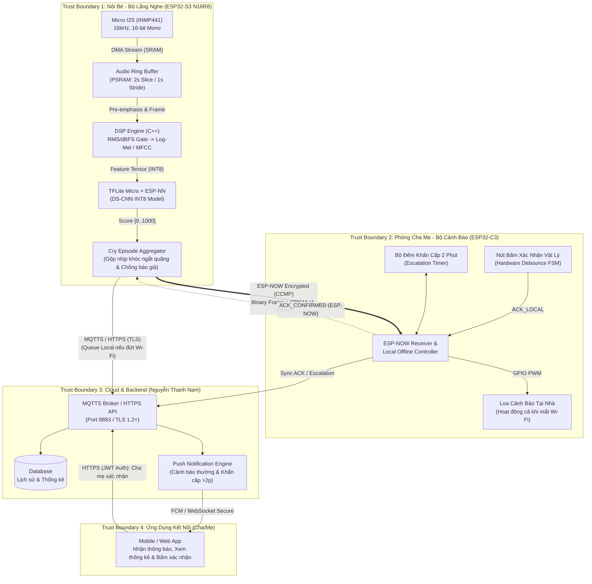
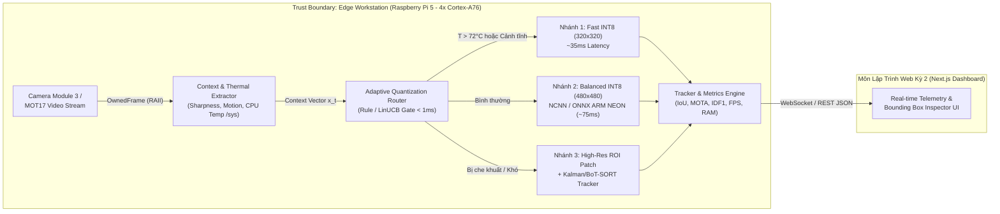

# MASTER PLAN NĂM 2 (2026–2027): QUẢN TRỊ LỘ TRÌNH, KIẾN TRÚC LIÊN DỰ ÁN & ĐIỀU PHỐI 7 CONVERSATIONS
*(Bản Hợp Đồng Thực Thi Chính Thức — Cập nhật ngày 08/11/2026 cho Đào Minh Dân)*

---

## PHẦN 1: KIỂM ĐỊNH LỘ TRÌNH (`ROADMAP AUDITOR` & `RESEARCH WEB EVIDENCE`)

### 1.1. Kết quả Kiểm định (`DEEP AUDIT`)
- **Audit Mode:** `DEEP AUDIT`
- **Target Role & Capability Horizon:** Kỹ sư **Embedded Edge AI & Computer Vision** cuối Năm 2 đạt ngưỡng **`independent prototype capability` + `early research-capable`** (đủ năng lực độc lập xây dựng pipeline từ dữ liệu thô $\rightarrow$ huấn luyện & nén mô hình `INT8` $\rightarrow$ nhúng lên `ESP32-S3` / `Raspberry Pi 5` với C++17/FreeRTOS an toàn bộ nhớ, đồng thời đạt **IELTS 7.0–7.5**).
- **`STRUCTURAL VERDICT`:** **`PASS WITH CHANGES`** (`VERDICT CONFIDENCE: HIGH`) — Cấu trúc mục tiêu hoàn toàn khớp với đích đến Năm 3 (Olympic AI, NCKH viết báo, Kaggle, Hackathon), nhưng bắt buộc phải hợp nhất các luồng rời rạc theo bảng *Change Specification* bên dưới.
- **`PERSONAL FEASIBILITY VERDICT`:** **`PASS WITH CHANGES`** (`VERDICT CONFIDENCE: HIGH`) — Khả thi trong ngân sách **8–10 giờ/ngày (55–65 giờ/tuần)** khi giảm Daily Challenge xuống 4–5 buổi/tuần và khóa phạm vi (Scope Freeze) dự án `EDGE-QUANT` trên Pi 5 cho đến khi hoàn tất các mốc học thuật tháng 11–12.

### 1.2. Đối chiếu Bằng chứng Thực nghiệm trên Web (`research-web-evidence`)
1. **Khả năng chạy suy luận Âm thanh `INT8` trên `ESP32-S3` (`CryCare`):**
   - `FACT`: Vi điều khiển `ESP32-S3` (Dual-core Xtensa LX7 @ 240 MHz) hỗ trợ tập lệnh vector SIMD (PIE) thông qua thư viện **ESP-NN** (tích hợp trong `TFLite Micro`) và **ESP-DL**.
   - `FACT`: Với các mô hình Keyword Spotting / Audio Classification gọn nhẹ như **DS-CNN** hoặc **Tiny ConvNet (`INT8`)** đầu vào phổ `MFCC` / `Log-Mel` nhỏ, thời gian suy luận (inference latency) chỉ mất từ **$5\text{ ms}$ đến $50\text{ ms}$**, trong khi các biến thể `YAMNet` lớn hơn mất khoảng **$300\text{–}500\text{ ms}$** mỗi cửa sổ 1–2 giây.
   - `INFERENCE`: Điểm nghẽn thực sự trên `ESP32-S3` không chỉ nằm ở mạng nơ-ron mà nằm ở khâu **trích xuất đặc trưng `FFT / Mel-Spectrogram / MFCC` bằng C/C++** và **căn chỉnh bộ nhớ 16-byte (16-byte alignment)** trong Internal SRAM để kích hoạt tập lệnh SIMD.
2. **Giao thức Liên lạc Cục bộ Không cần Wi-Fi giữa `ESP32-S3` và `ESP32-C3` (`CryCare`):**
   - `FACT`: Giao thức **ESP-NOW** của Espressif hoạt động trực tiếp ở tầng Data-Link (Layer 2), cho phép `ESP32-S3` (Xtensa) truyền gói tin cảnh báo sang `ESP32-C3` (RISC-V) mà **không cần Router Wi-Fi**, với độ trễ **$1\text{–}10\text{ ms}$** và tầm phủ sóng trong nhà **$20\text{–}50\text{ m}$** xuyên tường.
   - `RECOMMENDATION`: Vì `ESP32-S3` (Xtensa) và `ESP32-C3` (RISC-V) khác kiến trúc vi xử lý, gói tin truyền qua ESP-NOW bắt buộc dùng kiểu dữ liệu độ rộng cố định (`uint8_t`, `uint16_t`, `uint32_t`), đóng gói `#pragma pack(push, 1)` kèm mã kiểm tra **CRC-16** và cơ chế **Unicast ACK + Retry**.
3. **Hiệu năng Lượng tử hóa Thị giác Máy tính trên `Raspberry Pi 5` (`EDGE-QUANT` — `Self-Project #2`):**
   - `FACT`: Trên CPU `ARM Cortex-A76` (4 nhân) của `Raspberry Pi 5`, việc chuyển đổi mô hình `YOLOv8n` từ `FP32` sang **`INT8` (`NCNN` hoặc `ONNX Runtime` kích hoạt `ARM NEON SIMD`)** giảm kích thước mô hình xuống ~3–4 lần và đạt tốc độ **$35\text{–}88\text{ ms/frame}$ ($11\text{–}28\text{ FPS}$)** ở độ phân giải $320\times 320$ hoặc $480\times 480$, so với $150\text{–}350\text{ ms}$ ở `FP32` $640\times 640$.

### 1.3. Bảng Đặc tả Thay đổi (`Change Specification` — `roadmap-auditor`)

| Finding ID | Hành động | Hạng mục áp dụng | Lý do & Bằng chứng | Tiêu chí Nghiệm thu (`Acceptance Test`) |
| :---: | :---: | :--- | :--- | :--- |
| **F-01** | **`REDUCE` & `REORDER`** | `Phân Tích Daily Challenge` | Lịch 7 buổi/tuần × 90p (10.5h) xung đột trực tiếp với lịch học Thứ 3 (9h30–18h) và deadline CryCare. Giảm xuống **4–5 buổi/tuần × 60–75p** (Tối T2, T4, T5, T6, CN). | Không làm Daily Challenge vào Thứ 3; mỗi buổi chốt xong trong ngày (*Same-day Debrief*). |
| **F-02** | **`MERGE`** | `Computer Vision Study Plan` + `Self - Projects` | Gộp bài tập CV của thầy (`MOT17-02`, `YOLO + BoT-SORT`) làm phần **Baseline trên PC** của dự án cá nhân số 2 (`EDGE-QUANT`), sau đó nén `INT8` đưa xuống `Raspberry Pi 5`. | 1 codebase duy nhất phục vụ cả điểm số của thầy lẫn hồ sơ CV cá nhân. |
| **F-03** | **`CLARIFY` & `REPLACE`** | `Nhúng` (`CryCare`) | Thay thế hoàn toàn giả định dùng Pi 5 trong CryCare bằng kiến trúc **Dual-MCU (`ESP32-S3` + `ESP32-C3`)** theo đúng PDF của đội Archeon. Pi 5 chỉ dùng cho `Self-Project #2 (EDGE-QUANT)` và làm bàn test mẫu khi cần. | Sơ đồ kiến trúc và code firmware CryCare chạy độc lập 100% trên `ESP32-S3` và `ESP32-C3`. |
| **F-04** | **`DEFER`** | `Daily` (`AEGIS` Pan-Tilt Servo & Federated Learning) | Hoãn phần cơ khí Pan-Tilt Servo và Federated Learning sang sau tháng 02/2027 để dồn 100% tài nguyên phần cứng cho `CryCare` (trước 10/01) và `EDGE-QUANT` (Học kỳ 2). | Không mua thêm servo/linh kiện cơ khí mới trước ngày 27/02/2027. |
| **F-05** | **`KEEP` & `SPLIT`** | `English Collocation Tracker Practice` | Giữ nguyên nhịp luyện **Speaking + Listening mỗi ngày** (từ nay đến hết tháng 12); từ **Tháng 01/2027** tách thêm 2 buổi/tuần cho **Reading & Writing** để kịp thi vào Hè 2027. | Duy trì log collocation hằng ngày + đạt Speaking mock 6.5+ vào tháng 01/2027. |

---

## PHẦN 2: QUẢN TRỊ LỘ TRÌNH 6 PHASES, SCOPE GATES & KILL CRITERIA (`custom-product-roadmap-governor`)

<roadmap_validation>
- Mỗi phase có exit criteria chưa? -> ĐÃ CÓ (Định lượng rõ ràng cho cả 6 Phases).
- Có kill/pivot criteria chưa? -> ĐÃ CÓ (Ngưỡng cắt bỏ tính năng khi trễ hạn hoặc vượt RAM/Latency).
- Có kế hoạch sau MVP không (Phase 4, 5, 6)? -> ĐÃ CÓ (Phase 4: Hardening & Soak Test 72h; Phase 5: Paid Pilot 10 hộ gia đình & Thi HK2; Phase 6: Scale & Bước đệm Năm 3).
- Dependencies giữa các phase có rõ ràng không? -> ĐÃ CÓ.
- Out-of-scope có được ghi rõ không? -> ĐÃ CÓ.
</roadmap_validation>

### 2.1. Vision & 12-Month Outcome
- **Vision:** Trở thành Kỹ sư **Embedded Edge AI & Computer Vision** có nền tảng toán học, thuật toán (DSA), kiến trúc hệ thống C++/Python thực chiến và tiếng Anh học thuật vững chắc ngay từ Năm 2.
- **12-Month Measurable Outcome (Đến Tháng 8/2027):**
  1. **Sản phẩm Startup `CryCare` (Flagship Project #1):** Hoàn thiện hệ thống phần cứng kép `ESP32-S3` (TinyML `INT8` nhận diện tiếng khóc) + `ESP32-C3` (Loa cảnh báo mất mạng) + App Cloud, vượt qua Vòng loại 2 (**10/01/2027**) và Pitching Chung kết (**27/02/2027**), thử nghiệm thực tế tại 10 hộ gia đình.
  2. **Dự án Cá nhân `EDGE-QUANT` (Flagship Project #2):** Hoàn thành bài tập CV của thầy (`MOT17-02` + `BoT-SORT` đạt điểm A/A+) và phát triển thành công bộ engine nén mô hình thị giác (`FP32` $\rightarrow$ `INT8` / Mixed-Precision) chạy thời gian thực ($\ge 15\text{–}25\text{ FPS}$) trên **Raspberry Pi 5**.
  3. **Học thuật Đại học (Baseline Năm 2):** Đạt điểm tổng kết $\ge 8.5/10$ (A) ở các môn cốt lõi: *Hệ điều hành*, *Xử lý ảnh số*, *Cấu trúc dữ liệu & Giải thuật (DSA)*, *Nhập môn Trí tuệ nhân tạo*, và *Lập trình Web & Ứng dụng*.
  4. **Tiếng Anh (IELTS):** Đạt **IELTS Overall 7.0 – 7.5** (Speaking $\ge 7.0$) trong kỳ thi Hè Năm 2 (Tháng 7–8/2027).

### 2.2. Ba Canh bạc Chiến lược (`Strategic Bets`)
1. **Bet #1 (CryCare Edge Audio):** Vi điều khiển `ESP32-S3 N16R8` đủ sức trích xuất đặc trưng âm thanh (`Log-Mel` / `MFCC`) bằng C++ và chạy mô hình `DS-CNN INT8` trong thời gian thực ($< 150\text{ ms}$) với độ chính xác F1-score $\ge 88\%$, không cần đẩy raw audio lên Cloud hay dùng Raspberry Pi 5.
2. **Bet #2 (EDGE-QUANT Vision Compression):** Kỹ thuật lượng tử hóa `INT8` kết hợp cổng quyết định thích ứng (Adaptive Routing) giúp chạy mô hình phát hiện & theo dõi đối tượng (`YOLO` + `BoT-SORT`/Kalman) mượt mà trên CPU `Raspberry Pi 5` mà không cần mua card tăng tốc NPU rời đắt tiền.
3. **Bet #3 (Synergy Learning):** Việc gắn chặt bài tập **Daily Challenge** và **Đồ án môn học trên trường** vào chính các module của `CryCare` và `EDGE-QUANT` giúp tiết kiệm 40% thời gian học mà vẫn hiểu sâu tận gốc toán học/thuật toán (Zero Vibe-Coding).

### 2.3. Chi tiết 6 Phases & Cổng Kiểm soát (`Scope Gates`)

#### Phase 1 — Giải phóng Học kỳ 1, Chốt CV Baseline & Tiền xử lý CryCare (09/11/2026 – 06/12/2026 | 4 Tuần)

| Mục | Chi tiết |
| :--- | :--- |
| **Hypothesis** | Có thể hoàn thành xuất sắc 2 môn cuối kỳ (HĐH, Xử lý ảnh số) và bài CV của thầy trong khi vẫn huấn luyện xong mô hình Baseline + `DS-CNN` của CryCare trên PC. |
| **Deliverable** | 1. Bài thuyết trình HĐH + Báo cáo cuối kỳ Xử lý ảnh số.<br>2. Notebook Colab tính `Vectorized IoU` + Pipeline `YOLO + BoT-SORT` trên `MOT17-02` (`FinalReport_CV.pdf`) & `Essay_CV.pdf`.<br>3. Bộ dữ liệu cân bằng `CryCare` (fix lỗi zero-padding trong `preprocessing.py`), hoàn thành code `SoftmaxRegression` baseline + train `DS-CNN` xuất file `.tflite` `INT8`. |
| **Metric** | - Báo cáo CV nộp đúng hạn Thứ Tư (11/11) & cuối kỳ.<br>- Dataset CryCare đạt $\ge 40.000$ mẫu cân bằng (50% Cry / 50% Noise); mô hình `DS-CNN INT8` đạt `F1-score >= 0.88` trên tập Test độc lập theo người nói (Speaker-independent split).<br>- Tiếng Anh: Duy trì Speaking drill mỗi ngày + 3 buổi Mentor/tuần. |
| **Exit Criteria (`Scope Gate 1`)** | Thi xong Học kỳ 1; nộp xong báo cáo CV của thầy; có sẵn file `crycare_dscnn_int8.tflite` (dung lượng $< 300\text{ KB}$) trên ổ `E:\`. |
| **Kill / Pivot Criteria** | - Nếu tự tải và xử lý 160.000 mẫu audio làm tràn ổ `E:\` (còn trống 36.3 GB) hoặc mất quá 4 ngày $\rightarrow$ **PIVOT:** Giới hạn tập train ở mức **40.000 mẫu chất lượng cao** (20k Cry + 20k Hard Negative Noise).<br>- Nếu tự code `DS-CNN` từ con số 0 bằng NumPy quá lâu $\rightarrow$ **KILL:** Chỉ tự code `SoftmaxRegression` bằng NumPy để hiểu đạo hàm, còn `DS-CNN` dùng chuẩn `TensorFlow/Keras` hoặc `PyTorch -> TFLite` để kịp nhúng xuống chip. |
| **Risk** | Quá tải tuần 09/11–15/11 do trùng lịch thuyết trình HĐH, báo cáo DIP và Seminar PyTorch Thứ Tư. |
| **Dependency** | Máy tính cá nhân (RTX 4050 6GB), Google Colab, phối hợp với Tạ Chấn Nam (AI - Audio DSP). |
| **Out of Scope** | **CẤM** đụng vào code phần cứng `Raspberry Pi 5` cho dự án `EDGE-QUANT` trong 4 tuần này; **CẤM** ôn dàn trải Reading/Writing IELTS khi đang thi cuối kỳ. |
| **Owner** | Đào Minh Dân (Nhúng & Pipeline) + Tạ Chấn Nam (Hỗ trợ train/tune Audio DSP). |
| **Estimated Effort** | 55 giờ/tuần × 4 tuần = 220 giờ. |

#### Phase 2 — Chiến dịch Nhúng `CryCare` lên `ESP32-S3` & `ESP32-C3` cho Vòng Loại 2 (07/12/2026 – 10/01/2027 | 5 Tuần)

| Mục | Chi tiết |
| :--- | :--- |
| **Hypothesis** | Từ ngày 07/12 đến 20/12 (2 tuần nghỉ giữa kỳ hoàn toàn rảnh việc trường), Dân có thể hoàn tất 80% khối lượng nhúng C++ trên `ESP32-S3` và `ESP32-C3` trước khi Học kỳ 2 bắt đầu vào ngày **21/12/2026**. |
| **Deliverable** | 1. **Bộ lắng nghe (`ESP32-S3`):** Firmware C++ (ESP-IDF v6.1) đọc Micro I2S (16kHz DMA) $\rightarrow$ trích xuất `Log-Mel/MFCC` $\rightarrow$ chạy `TFLite Micro + ESP-NN (INT8)` trong PSRAM/SRAM $\rightarrow$ thuật toán **Alert Gate** (gộp các nhịp khóc ngắt quãng thành 1 đợt).<br>2. **Bộ cảnh báo (`ESP32-C3`):** Nhận tín hiệu qua **ESP-NOW** (kể cả khi tắt Router Wi-Fi), phát loa cảnh báo tại nhà, có nút bấm vật lý xác nhận.<br>3. **Tích hợp App/Cloud:** Gửi gói tin sự kiện qua MQTTS/HTTP sang hệ thống của Nguyễn Thanh Nam + logic cảnh báo khẩn sau **2 phút** nếu cha mẹ chưa bấm xác nhận.<br>4. Video Demo thực tế ($\le 5$ phút) + Hồ sơ kỹ thuật nộp Vòng loại 2 trước **10/01/2027**. |
| **Metric** | - Độ trễ suy luận trên `ESP32-S3` $\le 200\text{ ms}$/cửa sổ.<br>- Độ trễ truyền cảnh báo `ESP32-S3` $\rightarrow$ `ESP32-C3` qua ESP-NOW $\le 20\text{ ms}$ (tỷ lệ nhận thành công $\ge 99\%$ trong phạm vi 15m).<br>- Sử dụng Internal SRAM $\le 390\text{ KB}$, PSRAM $\le 2.8\text{ MB}$, `0` lỗi Watchdog Reset. |
| **Exit Criteria (`Scope Gate 2`)** | Sản phẩm phần cứng gồm 2 hộp (`ESP32-S3` + `ESP32-C3`) chạy mượt mà khi rút dây cáp khỏi máy tính (dùng nguồn rời/pin), phát loa khi có tiếng khóc, tắt báo động khi bấm nút, và hiện thông báo trên App. |
| **Kill / Pivot Criteria** | - Nếu viết bộ trích xuất `Log-Mel 32-band` bằng C++ thuần trên `ESP32-S3` bị sai lệch số học dấu chấm động so với `librosa` của Python quá $5\%$ sau ngày **20/12/2026** $\rightarrow$ **PIVOT:** Sử dụng thư viện chuẩn **`esp-dsp`** (hàm `dsps_fft2r_fc32_ae32` tối ưu riêng cho S3) hoặc chuyển sang đặc trưng `MFCC 20-dim` gọn nhẹ đã khớp 100% toán học.<br>- Nếu kết nối đồng thời cả `ESP-NOW` và `Wi-Fi Cloud` trên cùng 1 anten của `ESP32-S3` gây rớt gói do lệch kênh (Wi-Fi Channel Hopping) $\rightarrow$ **PIVOT:** Cố định kênh Wi-Fi hoặc cho `ESP32-S3` chỉ bắn `ESP-NOW` sang `ESP32-C3`, và để `ESP32-C3` làm Gateway đẩy lên Cloud/App! |
| **Risk** | Ngày **21/12/2026** bắt đầu Học kỳ 2 (`DSA`, `Nhập môn AI`, `Web`). Nếu để việc nhúng dồn sang cuối tháng 12 sẽ bị kẹt cứng. |
| **Dependency** | Kit `ESP32-S3 N16R8`, `ESP32-C3`, Micro I2S (INMP441), Module Loa/Buzzer, Nút nhấn, API Backend từ Nguyễn Thanh Nam. |
| **Out of Scope** | Không sử dụng `Raspberry Pi 5` trong sản phẩm; không phân loại 5–8 nguyên nhân khóc (đói, đau bụng, buồn ngủ) ở bản Vòng 2 — chỉ tập trung **Phát hiện tiếng khóc chuẩn xác & chống báo giả tuyệt đối** đúng như quy trình 4 bước trên Slide. |
| **Owner** | Đào Minh Dân (Trưởng nhóm - Nhúng) phối hợp cùng Tạ Chấn Nam & Nguyễn Thanh Nam. |
| **Estimated Effort** | 58 giờ/tuần × 5 tuần = 290 giờ (Dồn trọng tâm cao nhất vào 2 tuần vàng **07/12 – 20/12**). |

#### Phase 3 — Làm chủ Học kỳ 2 (`DSA` + `AI` + `Web`), Chung kết `CryCare` & Khởi động `EDGE-QUANT` (11/01/2027 – 28/02/2027 | 7 Tuần)

| Mục | Chi tiết |
| :--- | :--- |
| **Hypothesis** | Sau khi nộp Vòng 2 (10/01), có thể chuyển trọng tâm sang giữ nhịp 3 môn nền tảng cực quan trọng của Học kỳ 2 (`DSA`, `Nhập môn AI`, `Web`), chuẩn bị Pitching Chung kết `CryCare` (**27/02/2027**), và khởi động Sprint 1 của `EDGE-QUANT` trên `Raspberry Pi 5`. |
| **Deliverable** | 1. **Chung kết `CryCare` (27/02/2027):** Bản phần cứng đóng vỏ hoàn chỉnh, kịch bản xử lý sự cố trực tiếp trên sân khấu (Hall 10F TDTU), slide báo cáo thông số kỹ thuật thực nghiệm (Latency, RAM, Pin, Độ chính xác).<br>2. **Môn Học kỳ 2:** Hoàn thành toàn bộ bài lab tháng 1–2 của `DSA`, `Nhập môn AI`, `Web`.<br>3. **`Self-Project #2 (EDGE-QUANT)` — Sprint 1:** Chuyển mô hình CV đã làm cho thầy sang định dạng `ONNX` / `NCNN`, viết khung xương C++17 / Python sạch trên `Raspberry Pi 5`.<br>4. **Tiếng Anh:** Bắt đầu bổ sung **Reading & Writing** (2 buổi/tuần) bên cạnh Speaking hằng ngày. |
| **Metric** | - `CryCare` chạy ổn định 100% trong buổi thuyết trình Chung kết 10 phút.<br>- Đo được bảng đối chiếu Baseline `FP32` vs `INT8` đầu tiên trên `Raspberry Pi 5`. |
| **Exit Criteria (`Scope Gate 3`)** | Hoàn tất Chung kết Startup `CryCare` (27/02/2027); nắm vững các cấu trúc dữ liệu cốt lõi của môn `DSA`; `Raspberry Pi 5` chạy được suy luận ảnh/video đầu tiên bằng mô hình nén. |
| **Kill / Pivot Criteria** | Nếu tuần lễ trước ngày Pitching (18/02 – 27/02) đội cần dồn sức hoàn thiện sản phẩm và tập thuyết trình $\rightarrow$ **Tạm dừng 100% việc code `EDGE-QUANT` trong 10 ngày đó** để bảo vệ giải thưởng cuộc thi. |
| **Risk** | Áp lực kép sau Tết Nguyên Đán giữa bài tập trên trường và Chung kết Startup. |
| **Dependency** | `Raspberry Pi 5` + Camera Module 3, thiết bị `CryCare` hoàn chỉnh. |
| **Out of Scope** | Chưa tích hợp thuật toán Học tăng cường (`LinUCB`) phức tạp vào `EDGE-QUANT` trước ngày 28/02/2027. |
| **Owner** | Đào Minh Dân. |
| **Estimated Effort** | 55 giờ/tuần × 7 tuần = 385 giờ. |

#### Phase 4 (Post-MVP 1: Hardening) — Hoàn thiện `EDGE-QUANT` trên Pi 5 & Kiểm định Bền bỉ `CryCare` (01/03/2027 – 30/04/2027 | 9 Tuần)

| Mục | Chi tiết |
| :--- | :--- |
| **Hypothesis** | Giai đoạn giữa và cuối Học kỳ 2 là thời điểm vàng để hợp nhất môn **Lập trình Web**, **Nhập môn AI** và **DSA** vào dự án **`EDGE-QUANT`** (trên Pi 5) và nâng cấp độ bền (**Soak Test 72h + Bảo mật**) cho **`CryCare`**. |
| **Deliverable** | 1. **Hoàn thiện `Self-Project #2 (EDGE-QUANT)`:** Tích hợp đầy đủ 3 nhánh suy luận (`INT4/Fast`, `INT8/Balanced`, `Mixed-Precision ROI Patch`) điều phối bởi bộ chọn thích ứng dựa trên độ phức tạp ảnh & nhiệt độ CPU Pi 5 (`/sys/class/thermal/thermal_zone0/temp`).<br>2. **Hợp nhất môn Web & AI:** Xây dựng Web Dashboard thời gian thực hiển thị Telemetry (FPS, CPU Temp, RAM, Bbox/Audio Alerts) phục vụ đồ án cuối kỳ môn **Lập trình Web & Ứng dụng**.<br>3. **Hardening `CryCare`:** Chạy **Soak Test 72 giờ liên tục** trên `ESP32-S3/C3`, bật `Task Watchdog`, `NVS Encryption`, kiểm tra độ lệch bộ nhớ (`free_heap` biến thiên $< 5\%$). |
| **Metric** | - `EDGE-QUANT` trên Pi 5 giảm độ trễ $\ge 4\text{–}6\times$ so với `FP32`, giữ nhiệt độ CPU $< 68^\circ\text{C}$ khi chạy liên tục.<br>- Đồ án môn `Web`, `AI`, `DSA` đạt điểm tối đa (9.0–10.0). |
| **Exit Criteria (`Scope Gate 4`)** | Cả 2 dự án lớn (`CryCare` và `EDGE-QUANT`) đều có GitHub Repository chuẩn công nghiệp (kèm UML, ADR, Test Matrix, Video Demo, Benchmark Table) sẵn sàng đưa vào CV. |
| **Kill / Pivot Criteria** | Nếu nhánh `INT4` gây tụt độ chính xác (`mAP`) quá $5\%$ trên Pi 5 $\rightarrow$ **PIVOT:** Sử dụng cặp **`INT8` ($320\times 320$ Fast)** và **`INT8/FP16` ($640\times 640$ ROI Crop)** — vẫn đảm bảo tính thích ứng đa mức mà không làm hỏng chất lượng nhận diện. |
| **Risk** | Thi cuối kỳ Học kỳ 2 vào tháng 5. |
| **Dependency** | `Raspberry Pi 5`, `ESP32-S3/C3`, môn học trên trường. |
| **Out of Scope** | Không mở thêm dự án thứ 3. |
| **Owner** | Đào Minh Dân. |
| **Estimated Effort** | 55 giờ/tuần × 9 tuần = 495 giờ. |

#### Phase 5 (Post-MVP 2: Paid Pilot & Exam) — Thi Cuối Kỳ 2 & Thử nghiệm Thực tế 10 Hộ Gia đình (01/05/2027 – 15/06/2027 | 6 Tuần)

| Mục | Chi tiết |
| :--- | :--- |
| **Hypothesis** | Đạt điểm A/A+ toàn bộ các môn Học kỳ 2 (`DSA`, `AI`, `Web`) và thu thập dữ liệu vận hành thực tế của `CryCare` (Giai đoạn 2 trên Slide Kinh doanh). |
| **Deliverable** | 1. Hoàn tất kỳ thi cuối Học kỳ 2 Năm 2 với GPA cao.<br>2. Đóng gói 3–5 bộ prototype `CryCare` thử nghiệm thực tế (Pilot) và thu thập log/feedback.<br>3. Hoàn thành bộ đề luyện **IELTS 4 kỹ năng** (Full Mock Tests đạt 7.0). |
| **Metric** | - Điểm tổng kết `DSA`, `AI`, `Web` $\ge 8.5$.<br>- IELTS Mock Test đạt $\ge 7.0$ ở ít nhất 3 đề liên tiếp. |
| **Exit Criteria (`Scope Gate 5`)** | Xong toàn bộ chương trình Năm 2 trên trường; sẵn sàng 100% cho kỳ thi IELTS mùa hè. |
| **Kill / Pivot Criteria** | Trong 3 tuần thi cuối kỳ (tháng 5), cắt giảm 80% thời gian code dự án ngoài để bảo vệ tuyệt đối GPA học thuật trên trường. |
| **Risk** | Lịch thi dày đặc. |
| **Dependency** | Lịch thi của trường TDTU. |
| **Out of Scope** | Không nhận thêm task tính năng mới trong mùa thi. |
| **Owner** | Đào Minh Dân. |
| **Estimated Effort** | 50 giờ/tuần × 6 tuần = 300 giờ. |

#### Phase 6 (Post-MVP 3: Scale & Year 3 Launchpad) — Chinh phục IELTS 7.0–7.5 & Khởi động NCKH / Olympic AI Năm 3 (16/06/2027 – 31/08/2027 | 10 Tuần Hè)

| Mục | Chi tiết |
| :--- | :--- |
| **Hypothesis** | Khi đã giải phóng hoàn toàn việc trường và có sẵn 2 dự án lớn (`CryCare` + `EDGE-QUANT`), mùa hè là lúc bứt tốc thi lấy bằng **IELTS 7.0–7.5** và viết đề cương **Nghiên cứu khoa học (Paper)** + luyện **Olympic AI / Kaggle**. |
| **Deliverable** | 1. **Chứng chỉ IELTS chính thức đạt 7.0 – 7.5**.<br>2. **Bản thảo Đề cương Nghiên cứu Khoa học (Research Proposal)** kết hợp giữa `CryCare` (Edge Audio) và `EDGE-QUANT` (Adaptive Edge Vision Compression) trình giảng viên hướng dẫn.<br>3. Hoàn thành CV cá nhân chuẩn Quốc tế + Portfolio GitHub có 2 Flagship Projects hoàn chỉnh. |
| **Metric** | - Bằng IELTS $\ge 7.0$.<br>- 2 Dự án Flagship đạt chuẩn `CAPSTONE / PORTFOLIO EVIDENCE`.<br>- 1 Đề tài NCKH được thầy nhận hướng dẫn cho Năm 3. |
| **Exit Criteria (`Scope Gate 6`)** | Hoàn thành mỹ mãn 100% mục tiêu Năm 2, bước vào Năm 3 với tâm thế dẫn đầu. |
| **Kill / Pivot Criteria** | Nếu điểm Mock Writing/Reading đầu tháng 6 còn dưới 6.5 $\rightarrow$ Dành 60% thời gian tháng 6–7 cho IELTS trước khi đăng ký ngày thi chính thức. |
| **Risk** | Mất đà sau khi nghỉ hè. |
| **Dependency** | Mentor Tiếng Anh, Giảng viên hướng dẫn CV/Nhúng. |
| **Out of Scope** | Không ôm đồm quá 1 cuộc thi AI cùng lúc. |
| **Owner** | Đào Minh Dân. |
| **Estimated Effort** | 50 giờ/tuần × 10 tuần = 500 giờ. |

---

## PHẦN 3: KIẾN TRÚC HỆ THỐNG, STRIDE SECURITY & QUY CHUẨN KỸ THUẬT

### 3.1. Sơ đồ Kiến trúc & Ranh giới Tin cậy Hệ thống `CryCare` (Đội Archeon)



### 3.2. Sơ đồ Kiến trúc `Self-Project #2 (EDGE-QUANT)` trên `Raspberry Pi 5`



---

## PHẦN 4: ĐIỀU PHỐI 7 CONVERSATIONS (`custom-agent-orchestrator`)

| STT | Tên Conversation | Vai trò & Nhiệm vụ Duy nhất (`Scope Lock`) | Các Skills Gắn Chặt | Tần suất Mở | CẤM Làm (`Anti-Patterns`) |
| :-: | :--- | :--- | :--- | :--- | :--- |
| **1** | **`Nhúng`** | Phát triển Firmware C++ (`ESP-IDF v6.1`) cho Bộ lắng nghe `ESP32-S3` và Bộ cảnh báo `ESP32-C3` của **CryCare** (I2S Mic, DSP C++, TFLite Micro, ESP-NOW, Loa, Nút nhấn). | `custom-edge-ai-specialist`<br>`custom-embedded-safety-engineer`<br>`custom-debug-and-observability-engineer`<br>`custom-firmware-test-engineer` | 3–4 buổi/tuần (Trọng tâm số 1 từ tháng 12) | Cấm bàn chuyện bài tập CV của thầy hay luyện IELTS ở đây. |
| **2** | **`Học thuật`** | Thiết kế OOP Python Pipeline, xử lý Dataset, huấn luyện `Softmax` & `DS-CNN`, lượng tử hóa `INT8` và kiến trúc bảo mật/hệ thống cho **CryCare**. | `ml-best-practices`<br>`managing-python-dependencies`<br>`custom-system-architecture-designer`<br>`custom-secure-by-design-iot` | 2–3 buổi/tuần (Trọng tâm tháng 11) | Cấm vibe-coding; mọi class phải tuân thủ kiến trúc Abstract Class và chống Data Leakage. |
| **3** | **`Computer Vision Study Plan`** | Học bản chất Toán/PyTorch Tensor và hoàn thành 100% bài tập CV của thầy (`Vectorized IoU`, `MOT17-02` + `BoT-SORT`, `Essay_CV.pdf`, `FinalReport_CV.pdf`). | `ml-best-practices`<br>`notebook-guidance`<br>*(Zero Vibe-Coding: Chỉ cấp API & Workflow)* | 2–3 buổi/tuần | Cấm AI viết sẵn code lời giải hoàn chỉnh; chỉ giải thích định nghĩa, công thức, API và chấm code của Dân. |
| **4** | **`Self - Projects`** | Thực thi **Dự án Cá nhân số 2 (`EDGE-QUANT`)**: Đưa mô hình CV xuống **Raspberry Pi 5**, nén `INT8` (`NCNN`/`ONNX`), đo nhiệt độ/FPS và rèn luyện tiếng Anh kỹ thuật qua code. | `custom-edge-ai-specialist`<br>`custom-embedded-safety-engineer`<br>`custom-firmware-test-engineer` | Tạm nghỉ đến **06/12**; mở lại từ Phase 2–4 | Cấm mở tính năng mới trên Pi 5 khi chưa xong hạn nộp bài trường và Vòng 2 CryCare. |
| **5** | **`Daily`** | Phòng **Hội đồng Thẩm định & Phản biện Kiến trúc (`Technical Defense & Architecture Review`)** cho cả `CryCare` và `EDGE-QUANT` trước khi gặp Mentor/Giám khảo. | `custom-architecture-designer`<br>`custom-system-architecture-designer`<br>`custom-product-roadmap-governor` | 1 buổi/tuần (Khi cần phản biện sâu hoặc vẽ Infographic) | Không dùng để debug lỗi cú pháp lặt vặt. |
| **6** | **`Phân Tích Daily Challenge`** | Luyện tư duy thuật toán, cấu trúc dữ liệu (`DSA`) và xử lý luồng dữ liệu biên qua các đề thi 60–75 phút (**4–5 buổi/tuần**: T2, T4, T5, T6, CN). | Quy tắc *Zero Vibe-Coding* & *Same-day Debrief* | 4–5 tối/tuần (19h00–20h15) | **Nghỉ tối Thứ 3**; không để bài tập kéo dài qua đêm gây tốn RAM não bộ. |
| **7** | **`English Collocation Tracker Practice`** | Luyện phản xạ **IELTS Speaking 7.0+** mỗi ngày (2–3 chủ đề/tuần, 3–5 collocations/ngày + ôn tập ngày 3-5-7) và chuẩn bị bài nói với Mentor. | Hệ thống *Daily Reflex & Thematic Spiral Engine* | Hằng ngày (30–45p) + 3 buổi Mentor | Không học từ vựng học thuật sáo rỗng, lỗi thời. |


---

## PHẦN 5: ĐẶC TẢ THÀNH PHẦN, BẢO MẬT STRIDE & ADR (`custom-system-architecture-designer`, `custom-secure-by-design-iot`)

### 5.1. Đặc tả Thành phần (`Component Specification`)

| Component | Trách nhiệm (`Responsibility`) | Công nghệ (`Technology`) | Ngân sách Tài nguyên (`Budget`) | Chế độ Lỗi (`Failure Mode`) | Cơ chế Tự phục hồi (`Recovery`) |
| :--- | :--- | :--- | :--- | :--- | :--- |
| **`CryCare` Bộ Lắng Nghe (`ESP32-S3`)** | Thu âm I2S, lọc khoảng lặng (`dBFS`), trích xuất đặc trưng, chạy `DS-CNN INT8`, gộp đợt khóc và phát lệnh cảnh báo. | ESP-IDF v6.1, FreeRTOS, TFLite Micro + ESP-NN, ESP-NOW, MQTTS. | SRAM $\le 390\text{ KB}$, PSRAM $\le 2.8\text{ MB}$, Latency $\le 200\text{ ms}$. | Mất Wi-Fi; nhiễu âm thanh lớn (tiếng tivi/người lớn); treo task do lỗi ngoại vi. | Mất Wi-Fi vẫn bắn ESP-NOW sang C3 và lưu vào Ring Buffer; lọc nhiễu bằng 2 lần xác nhận liên tiếp (Alert Gate); tự khởi động lại qua Task Watchdog. |
| **`CryCare` Bộ Cảnh Báo (`ESP32-C3`)** | Nhận gói ESP-NOW từ S3, phát loa báo động, đọc nút nhấn xác nhận của mẹ, đếm ngược 2 phút để báo khẩn cấp. | ESP-IDF v6.1, FreeRTOS, ESP-NOW, GPIO Interrupt + Debounce FSM. | SRAM $\le 250\text{ KB}$, Phản hồi nút bấm $< 20\text{ ms}$. | Mất gói tin ESP-NOW; cha mẹ không nghe thấy loa trong 2 phút. | Tự động gửi `ACK` về S3; nếu sau 2 phút chưa có tín hiệu bấm nút vật lý hoặc ACK từ App $\rightarrow$ Tăng âm lượng loa tối đa + bắn cờ `URGENT_ESCALATION` lên App. |
| **`EDGE-QUANT` Engine (`Raspberry Pi 5`)** | Chạy pipeline Phát hiện & Theo dõi đa đối tượng (`YOLO` + `BoT-SORT`) đã lượng tử hóa `INT8` và giám sát nhiệt độ/tài nguyên. | Python 3 / C++17, PyTorch, Ultralytics, NCNN / ONNX Runtime, OpenCV. | Latency $35\text{–}90\text{ ms}$, Nhiệt độ CPU $< 72^\circ\text{C}$, RAM $< 500\text{ MB}$. | Quá nhiệt CPU ($> 75^\circ\text{C}$) gây sụt xung; mất dấu ID (`ID Switch`) khi người đi ngang che khuất. | Tự động hạ xuống Nhánh 1 (`320x320 INT8`) khi nhiệt độ $\ge 72^\circ\text{C}$; dùng bộ lọc Kalman dự đoán vị trí hộp khi bị che khuất ngắn hạn. |

### 5.2. Mô hình Đe dọa `STRIDE` & Kiểm soát Bảo mật (`custom-secure-by-design-iot`)

| Mối đe dọa (`STRIDE`) | Bối cảnh trong `CryCare` | Hậu quả nếu không phòng vệ | Giải pháp Kỹ thuật Bắt buộc (`Mitigation`) |
| :--- | :--- | :--- | :--- |
| **S — Spoofing (Giả mạo)** | Kẻ xấu gần nhà dùng một mạch ESP32 khác phát gói tin `ESP-NOW` giả mạo Bộ lắng nghe `ESP32-S3`. | Bộ cảnh báo `ESP32-C3` hú còi báo động giả liên tục lúc nửa đêm. | Bật **Mã hóa phần cứng `ESP-NOW` (CCMP-128)** với khóa `PMK` (Primary Master Key) và `LMK` (Local Master Key) 16-byte + kiểm tra địa chỉ MAC đã ghép đôi (`Peer Whitelist`). |
| **T — Tampering (Sửa đổi dữ liệu)** | Nhiễu điện từ hoặc tấn công Man-in-the-Middle làm sai lệch byte dữ liệu trong gói tin cảnh báo. | Sai lệch trạng thái cảnh báo hoặc làm crash bộ parser. | Đóng gói khung nhị phân có `Magic Header (0xA5 0x5A)`, `Sequence ID` chống phát lại (Anti-replay), và kiểm tra **`CRC16-CCITT`**. |
| **R — Repudiation (Chối bỏ)** | Không rõ cảnh báo đã được cha/mẹ bấm tắt ở nút vật lý hay trên App vào lúc nào. | Lỗi đồng bộ trạng thái giữa loa ở nhà và điện thoại. | Gắn mã định danh duy nhất **`event_id`** (`dev01_timestamp_seq`) cho mỗi đợt khóc; ghi log xác nhận có dấu thời gian vào NVS và Cloud. |
| **I — Information Disclosure (Rò rỉ)** | Lộ mật khẩu Wi-Fi, khóa MQTT hoặc rò rỉ âm thanh phòng ngủ. | Mất quyền riêng tư của gia đình; vi phạm cam kết cốt lõi trên Slide. | **Tuyệt đối không gửi raw audio qua mạng**; toàn bộ thông tin Wi-Fi/Token lưu trong phân vùng **`NVS Encrypted`** (không hardcode trong source code); dùng `MQTTS (TLS 1.2+)`. |
| **D — Denial of Service (Từ chối dịch vụ)** | Bé khóc ngắt quãng liên tục tạo ra hàng trăm thông báo làm treo App và ngập mạng. | Ứng dụng bị spam, đơ máy, hết pin. | Áp dụng thuật toán **Alert Gate & Episode Grouper** (đã luyện trong Daily Challenge `EDGE-2026-11-05`): gộp các nhịp khóc cách nhau $< \Delta t$ thành **1 đợt duy nhất** và khóa bắn lặp (Cooldown/Suppression). |
| **E — Elevation of Privilege (Leo thang)** | Người dùng khác trên hệ thống Cloud truy cập trái phép vào lịch sử khóc của gia đình. | Lộ dữ liệu sức khỏe của trẻ sơ sinh. | Xác thực **JWT + RBAC** trên Backend; mỗi thiết bị gắn chặt với tài khoản cha mẹ qua mã định danh `eFuse MAC / Device Certificate`. |

### 5.3. Hồ sơ Quyết định Kiến trúc (`Architecture Decision Records — ADR`)

```markdown
## ADR-001: Loại bỏ Raspberry Pi 5 khỏi bản thương mại CryCare, sử dụng kiến trúc Dual-MCU (ESP32-S3 + ESP32-C3)
- Status: Accepted (2026-11-08)
- Context: Sản phẩm CryCare cam kết giá linh kiện (BOM) chỉ ~400.000đ và giá bán 599.000đ (rẻ hơn 6-10 lần so với máy ngoại nhập 3.5 - 8 triệu đồng), đồng thời phải hoạt động ngay cả khi mất mạng Wi-Fi. Một bo mạch Raspberry Pi 5 đơn lẻ đã tốn > 1.800.000đ.
- Decision: Sử dụng ESP32-S3 N16R8 (~120.000đ) làm Bộ lắng nghe chạy AI tại biên và ESP32-C3 (~50.000đ) làm Bộ cảnh báo nối qua sóng trực tiếp ESP-NOW. Giữ Raspberry Pi 5 lại làm thiết bị chuyên dụng cho Dự án Cá nhân số 2 (EDGE-QUANT Computer Vision).
- Consequences:
  + (+) Đạt chuẩn chi phí BOM ~400.000đ như Slide Kinh doanh; khởi động tức thì (< 1s); tiêu thụ điện cực thấp; mất Wi-Fi vẫn báo động bình thường.
  - (-) Đòi hỏi kỹ năng lập trình C++ nhúng khắt khe hơn (quản lý SRAM/PSRAM, tối ưu hóa DSP và lượng tử hóa INT8).

## ADR-002: Giao thức truyền cảnh báo cục bộ ESP-NOW kết hợp khung nhị phân có xác nhận (Unicast ACK + Retry)
- Status: Accepted (2026-11-08)
- Context: Cảnh báo tiếng khóc trẻ sơ sinh là tác vụ quan trọng (Safety-critical). Nếu chỉ bắn 1 gói tin broadcast không kiểm tra, nhiễu sóng 2.4GHz có thể làm mất gói tin.
- Decision: Sử dụng ESP-NOW ở chế độ Unicast có mã hóa CCMP, kiểm tra callback `esp_now_register_send_cb`, tự động gửi lại tối đa 3 lần nếu không nhận được ACK trong 50ms, và duy trì gói tin nhịp tim (Heartbeat) mỗi 30 giây giữa S3 và C3.
- Consequences:
  + (+) Đảm bảo độ tin cậy gần như tuyệt đối trong phạm vi hộ gia đình mà không phụ thuộc Router.
  - (-) Cần đồng bộ kênh Wi-Fi (Channel) giữa ESP-NOW và kết nối Wi-Fi AP.
```

---

## PHẦN 6: QUY CHUẨN KỸ THUẬT NHÚNG, DEBUG & KIỂM THỬ (`custom-edge-ai-specialist`, `custom-embedded-safety-engineer`, `custom-debug-and-observability-engineer`, `custom-firmware-test-engineer`)

### 6.1. Kiến trúc Đa luồng FreeRTOS & Ngân sách Bộ nhớ trên `ESP32-S3` (`CryCare`)

Mọi file mã nguồn `.cpp` viết cho `ESP32-S3` và `ESP32-C3` **bắt buộc** mở đầu bằng khối Header Contract sau:

```cpp
/*
 * MEMORY_STRATEGY:
 *   - Internal SRAM (<= 390KB / 512KB): FreeRTOS Task Stacks, I2S DMA Descriptors, ISR Flags, FFT Twiddle Factors (16-byte aligned).
 *   - External Octal PSRAM (<= 2.8MB / 8MB): Audio Ring Buffer (2s @ 16kHz = 64KB), TFLite Micro Tensor Arena (256KB), Offline Event Queue.
 * MEMORY_BUDGET: SRAM used: ~180/390KB | PSRAM used: ~384KB/2.8MB
 * STACK_BUDGET: TaskAudioDMA: 4096B | TaskDSP_AI: 8192B | TaskAlertComm: 4096B | TaskHealthWDT: 3072B
 * POWER_STRATEGY: Continuous non-blocking via vTaskDelay() / xQueueReceive() portMAX_DELAY; Light Sleep when idle if battery-powered.
 * ALLOCATION_POLICY: All heap/PSRAM allocations via heap_caps_malloc() at app_main() boot only. ZERO dynamic allocations in loops or ISRs.
 */
```

#### Sơ đồ Luồng Task FreeRTOS trên `ESP32-S3`:
```text
[I2S Mic INMP441]
   │ (DMA Hardware Interrupt — chỉ đẩy dữ liệu vào DMA Buffer, 0% dùng Heap)
   ▼
[Task 1: TaskAudioCapture (Core 0, Priority 6)]
   │ Đọc khối PCM 16kHz từ I2S DMA ──► Ghi vào Ring Buffer tĩnh trong PSRAM
   │ Khi đủ cửa sổ 2.0s (trượt 1.0s) ──► xQueueSend(audio_window_queue)
   ▼
[Task 2: TaskDSP_Inference (Core 1, Priority 5 — Gắn cố định vào Core 1 để chạy SIMD)]
   │ 1. Tính RMS / dBFS: Nếu dBFS < -42.0 dB (im lặng) ──► Bỏ qua suy luận AI (Tiết kiệm 80% CPU!)
   │ 2. Nếu có âm thanh: Trích xuất Log-Mel / MFCC ──► Chạy TFLite Micro + ESP-NN (INT8)
   │ 3. Đưa điểm số qua bộ lọc Alert Gate (Xác nhận 2 nhịp liên tiếp + Gộp đợt khóc)
   │ 4. Nếu xác nhận KHÓC ──► Tạo sự kiện kèm event_id ──► xQueueSend(alert_tx_queue)
   ▼
[Task 3: TaskAlertComm (Core 0, Priority 4)]
   │ 1. Bắn gói nhị phân qua ESP-NOW sang ESP32-C3 (Unicast + Retry nếu thiếu ACK)
   │ 2. Đẩy JSON qua MQTTS/HTTPS lên Cloud của Thanh Nam (Nếu mất Wi-Fi -> Lưu vào Offline Ring Queue)
   ▼
[Task 4: TaskHealthMonitor (Core 0, Priority 2)]
   │ Reset Task Watchdog (esp_task_wdt_reset), đo free_heap, free_psram, stack HWM, nhiệt độ chip mỗi 60s.
```

### 6.2. Chuẩn hóa Mã lỗi & Giám sát (`custom-debug-and-observability-engineer`)

1. **Chuẩn Log có cấu trúc (Cấm dùng `printf("here")`):**
   ```text
   [TIMESTAMP_MS] [LEVEL] [COMPONENT] [EVENT_ID] message | key1=value1 key2=value2
   ```
2. **Bảng Mã lỗi Chuẩn (`Error Code Standard`):**
   - `AUDIO_ERR_001`: I2S DMA read timeout (Micro INMP441 bị lỏng dây hoặc mất xung clock).
   - `AI_ERR_001`: `heap_caps_malloc` cấp phát Tensor Arena trong PSRAM thất bại (`NULL`).
   - `AI_WARN_001`: Thời gian suy luận (`dsp_ms + infer_ms`) vượt ngưỡng $250\text{ ms}$.
   - `ESPNOW_ERR_001`: Gửi gói cảnh báo sang `ESP32-C3` thất bại sau 3 lần retry.
   - `WIFI_WARN_001`: Mất kết nối Wi-Fi Router — đã chuyển sang chế độ lưu hàng đợi Offline (`Offline Queue Mode`).

### 6.3. Ma trận Kiểm thử Phần cứng (`Test Matrix` — `custom-firmware-test-engineer`)

| Test ID | Nhóm | Yêu cầu Kiểm chứng | Môi trường | Đầu vào (`Input`) | Kết quả Kỳ vọng (`Expected Result`) | Tiêu chí `PASS / FAIL` |
| :---: | :--- | :--- | :--- | :--- | :--- | :--- |
| **T001** | **Unit (DSP Parity)** | Độ khớp toán học giữa C++ và Python | Host PC | 1 file `.wav` tiếng khóc chuẩn (2s, 16kHz) | Ma trận đặc trưng C++ khớp với Python `librosa` | Sai số tuyệt đối trung bình $\text{MAE} < 10^{-3}$; dự đoán cùng nhãn `1`. |
| **T002** | **Boundary (Audio)** | Chống lỗi $\log(0)$ và lọc im lặng | Host PC & S3 | Mảng toàn số `0` hoặc nhiễu nền `dBFS = -50 dB` | Không crash (`NaN`/`Inf`), bỏ qua bước chạy mạng AI | `infer_called == false`, trả về nhãn `0` trong $< 2\text{ ms}$. |
| **T003** | **Unit (Alert Gate)** | Gộp nhịp khóc & Chống báo giả | Host PC | Chuỗi điểm số: `[820, 400, 850, 880, 300, 860]` | Chỉ phát cảnh báo khi có 2 nhịp cao liên tiếp và gộp nhịp nghỉ ngắn thành 1 đợt | Đúng 100% với 8 bộ test chuẩn của `EDGE-2026-11-05`. |
| **T004** | **HIL Integration** | Chuỗi khép kín: Khóc $\rightarrow$ S3 $\rightarrow$ C3 $\rightarrow$ Loa $\rightarrow$ Nút bấm | `ESP32-S3` + `ESP32-C3` thật (Tắt Wi-Fi) | Phát âm thanh tiếng khóc cách micro 1 mét | S3 nhận diện $\rightarrow$ bắn ESP-NOW $\rightarrow$ C3 kêu loa $\rightarrow$ Bấm nút trên C3 loa tắt ngay | Tổng độ trễ từ lúc khóc đủ 2 nhịp đến lúc loa kêu $< 500\text{ ms}$. |
| **T005** | **Fault Injection** | Leo thang cảnh báo sau 2 phút không xác nhận | `ESP32-S3` + `ESP32-C3` + App | Kích hoạt cảnh báo nhưng **không** bấm nút xác nhận trong 120 giây | Đúng giây thứ 120, hệ thống bắn cờ `URGENT_2MIN_ALERT` lên App và tăng mức còi | Cờ khẩn cấp kích hoạt chính xác trong khoảng $120\text{s} \pm 1\text{s}$. |
| **T006** | **Performance** | Đo tốc độ suy luận và bộ nhớ trên chip | `ESP32-S3` thật | 100 cửa sổ âm thanh liên tiếp | In ra thống kê `p50`, `p95`, `p99` latency và RAM | `Median Latency <= 200ms`, `SRAM free >= 130KB`, `0` lỗi cấp phát. |
| **T007** | **Soak Test** | Độ ổn định dài hạn (24h trước Vòng 2 $\rightarrow$ 72h ở Phase 4) | `ESP32-S3` + `ESP32-C3` cắm nguồn liên tục | Hoạt động liên tục trong phòng có tiếng ồn sinh hoạt & test khóc định kỳ | Không bị treo, không rò rỉ bộ nhớ (Memory Leak) | `Watchdog Reset = 0`, `free_heap` giảm $< 5\%$ sau suốt phiên chạy. |

---

## PHẦN 7: QUY CHUẨN PIPELINE DỮ LIỆU ML & QUẢN LÝ MÔI TRƯỜNG (`ml-best-practices`, `managing-python-dependencies`)

1. **Quản lý Môi trường Python (`managing-python-dependencies`):**
   - **Tuyệt đối CẤM chạy `pip install` toàn cục (global).**
   - Luôn kích hoạt và cài đặt thông qua môi trường ảo `.venv` của dự án (`E:\TU_HOC\Edge_Project\self-CryCare\.venv\Scripts\python.exe`).
2. **Năm Quy tắc Vàng Chống Data Leakage & Huấn luyện Mô hình (`ml-best-practices`):**
   - **Chia tập dữ liệu theo Nguồn/Em bé TRƯỚC khi cắt cửa sổ 2 giây (`Group/Speaker-Aware Split BEFORE Slicing & Featurization`)** để chống rò rỉ dữ liệu giữa các cửa sổ trượt chồng lấp.
   - **Sửa lỗi Zero-Padding làm rơi 86.4% mẫu tiếng khóc trong `preprocessing.py`:** Tính `rms` và `dbfs` trên mảng âm thanh gốc `y` trước khi gọi `np.pad()` chèn số 0.
   - **Thang đo Đánh giá khớp với Bài toán Thực tế:** Xuất đầy đủ `Confusion Matrix`, `Precision`, `Recall`, `F1-score`, `PR-AUC` (cho CryCare) và `mAP@0.5`, `mAP@0.5:0.95`, `HOTA`, `MOTA`, `IDF1` (cho Computer Vision `MOT17-02`).
   - **Đối chiếu Mô hình có Đối chứng (`Controlled Model Comparison`):** Luôn lập bảng so sánh 3 cột trên cùng tập Test cố định: `Baseline (Softmax / YOLOv8n FP32)` vs `Target FP32` vs `Quantized INT8`.

---

## PHẦN 8: KẾ HOẠCH TÁC CHIẾN NGAY TUẦN TỚI (09/11 – 15/11/2026) & KHUNG 55 GIỜ/TUẦN

### 8.1. Lịch Tác Chiến Đặc Biệt cho Tuần Tới (09/11 – 15/11/2026)

| Ngày | Khung Giờ Sáng / Chiều | Khung Giờ Chiều Muộn (Tận dụng giờ trống trên trường) | Khung Giờ Tối (19h00 – 22h00) |
| :--- | :--- | :--- | :--- |
| **Thứ Hai (09/11)** | **09h00 – 12h00:** Làm **Thuyết trình Hệ điều hành** (Phần 1).<br>**13h30 – 16h30:** Sửa dòng tính `rms` trước `np.pad` trong `CryCare` + hoàn thiện `SoftmaxRegression`. | **16h30 – 17h30:** Hoàn thành cell code Colab tính **`Vectorized Box IoU` bằng PyTorch** (30p) tại `Computer Vision Study Plan`. | - **19h00 – 20h15:** **Daily Challenge #1** (Tập trung mảng/hàng đợi).<br>- **21h00 – 22h00:** **Tiếng Anh cùng Mentor** (Chủ đề 1: Phản xạ giới từ chỉ thời gian `in/on/at`). |
| **Thứ Ba (10/11)** | **09h30 – 15h00:** **Học kiến thức mới trên trường** (Tập trung 100% nghe giảng). | **15h30 – 18h00 (Làm việc riêng trên máy tại trường):**<br>- **15h30–17h00:** Chạy thử `.track(tracker="botsort.yaml")` trên `MOT17-02` bằng Google Colab để lấy video & kết quả chuẩn bị cho chiều Thứ Tư.<br>- **17h00–18h00:** Hoàn thiện **Slide Thuyết trình Hệ điều hành**. | - **Tối Thứ Ba: NGHỈ DAILY CHALLENGE** (để hồi phục sau ngày học 9h30–18h).<br>- **19h30 – 21h00:** Tập nói thử bài thuyết trình HĐH / Viết báo cáo **Xử lý ảnh số**.<br>- **21h00 – 21h45:** **Tiếng Anh tự học** (15p ôn nhanh Collocation). |
| **Thứ Tư (11/11)** | **09h30 – 12h00:** **Bắt buộc học trên trường**. | **13h00 – 18h00 (Làm việc riêng + Seminar PyTorch & Gặp Thầy):**<br>- **13h00–15h00:** Rà soát lại Notebook `PyTorch Broadcasting IoU` + kết quả `MOT17-02` để **Show Proof-of-Work cho Thầy**.<br>- **15h00–17h30:** Tham gia **Seminar PyTorch**. | - **19h00 – 20h15:** **Daily Challenge #2** (60p, dứt điểm trong ngày).<br>- **21h00 – 22h00:** **Tiếng Anh cùng Mentor** (Ôn tập Ngày 3 + Chủ đề 2). |
| **Thứ Năm (12/11)** | **09h30 – 16h30 (Ngồi trên trường nhưng được làm việc riêng):**<br>- **Ca sáng (09h30–12h00):** Viết dứt điểm **Báo cáo Cuối kỳ Xử lý ảnh số (DIP)** (tận dụng các ảnh Canny, Otsu, Adaptive Threshold đã có sẵn trong máy!). | - **Ca chiều (13h30–16h30):** Hoàn tất nốt **Thuyết trình Hệ điều hành** (đạt 100% xong 2 nợ môn trường!). | - **19h00 – 20h15:** **Daily Challenge #3**.<br>- **21h00 – 21h45:** **Tiếng Anh tự học** (Chủ đề 2). |
| **Thứ Sáu (13/11)** | **09h00 – 12h00:** **Dự án `CryCare`** (`Học thuật`): Huấn luyện `Softmax` & thiết kế kiến trúc mạng `DS-CNN` trên tập dữ liệu đã làm sạch. | **13h30 – 16h30:** **Computer Vision của Thầy**: Bắt đầu viết khung báo cáo `FinalReport_CV.pdf` (phân tích 2 tình huống lỗi `ID Switch` từ video `MOT17-02`). | - **19h00 – 20h15:** **Daily Challenge #4**.<br>- **21h00 – 21h45:** **Tiếng Anh tự học** (Ôn tập Ngày 5). |
| **Thứ Bảy (14/11)** | **09h00 – 12h00:** **Dự án `CryCare`** (`Nhúng`): Test đọc Micro I2S & giao thức `ESP-NOW` cơ bản giữa `ESP32-S3` và `ESP32-C3`. | **13h30 – 16h30:** Rà soát cuối cùng bài **HĐH & Xử lý ảnh số** + Họp nhanh nhóm Archeon. | - **19h00 – 20h15:** *(Tùy chọn)* **Daily Challenge #5** hoặc nghỉ ngơi.<br>- **21h00 – 22h00:** **Tiếng Anh cùng Mentor**. |
| **Chủ Nhật (15/11)** | **09h00 – 11h30:** Tổng kết tuần, cập nhật `handoff.md` và chuẩn bị bài CV tuần tiếp theo. | **12h00 – 20h30:** **NGHỈ NGƠI HOÀN TOÀN / THỂ THAO / GIA ĐÌNH** (Chống Burnout). | - **20h30 – 21h30:** **Tiếng Anh Tổng hợp Ngày 7 (Weekly Synthesis)** + Xem lại lịch tuần mới. |

### 8.2. Khung Phân Bổ Thời Gian Chuẩn Hằng Tuần (55 Giờ/Tuần — Trung bình 8 Giờ/Ngày)

| Hạng mục | Giờ / Tuần | Tỷ lệ | Nguyên tắc Bảo vệ Năng lượng |
| :--- | :---: | :---: | :--- |
| **1. Học trên trường + Bài tập môn học (`DSA`, `AI`, `Web`)** | **16.0h** | **29%** | Tận dụng tối đa thời gian trống ngay tại lớp để giải quyết xong bài tập trường, không mang nợ về nhà. |
| **2. Dự án Trọng tâm theo Pha (`CryCare` ở Pha 1–2 $\rightarrow$ `EDGE-QUANT` ở Pha 3–4)** | **15.0h** | **27%** | Chia làm 5 ca Deep Work × 3 tiếng (Thứ 2, Thứ 5, Thứ 6, Thứ 7). |
| **3. Computer Vision của Thầy & Seminar** | **8.0h** | **15%** | Làm trên Google Colab + tích hợp thẳng vào nền tảng của `EDGE-QUANT`. |
| **4. Tiếng Anh (IELTS 7.0–7.5)** | **7.0h** | **13%** | 1 giờ cố định mỗi tối (21h00–22h00): 3 buổi với Mentor + 4 buổi tự luyện phản xạ. |
| **5. Daily Challenge (Luyện Code & Tư duy Thuật toán)** | **5.5h** | **10%** | **4–5 buổi/tuần** × 60–75 phút (19h00–20h15 tối T2, T4, T5, T6, CN). **Nghỉ tối Thứ 3 & Thứ 7**. |
| **6. Buffer & Họp Đội Archeon / Review Lịch** | **3.5h** | **6%** | Dùng để bù cho các sự cố phần cứng hoặc nghỉ ngơi khi mệt. |
| **TỔNG CỘNG** | **55.0h** | **100%** | **Đúng ~8 tiếng/ngày** — bền vững suốt 10 tháng liên tục! |
